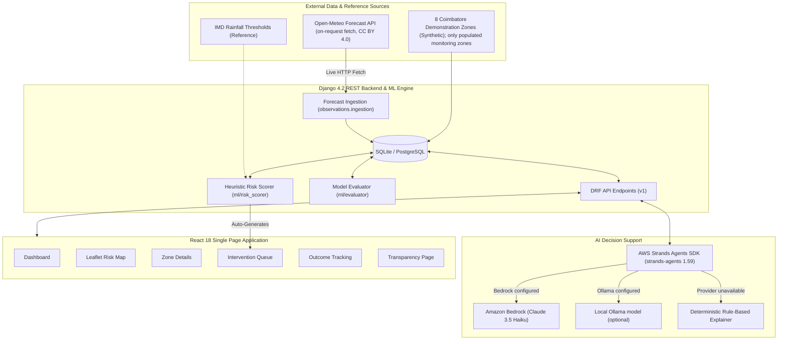

# DrainSense AI — Environmental Hacks 2026 Submission

**Track:** Heat & Water  
**Initial demonstration focus:** Coimbatore, Tamil Nadu, India (the geographic selectors do not imply wider data coverage)  
**Target Users:** Municipal drainage inspectors and disaster response coordinators  

---

## 1. Project Write-Up

### The Problem
During the monsoon season, Coimbatore faces severe local urban waterlogging. Surface runoff accumulates rapidly in low-lying pockets, older residential wards with restricted drainage networks, and corridors surrounding water bodies like Ukkadam Lake and the Noyyal river. 

Traditional flood tracking platforms only display static or historical map markers. Municipal teams face an urgent operational gap: **they know rain is coming, but they lack a system that tells them which drain needs intervention first, why that zone is prioritised, and what specific action crew members must take before inundation occurs.**

### The Solution: DrainSense AI
DrainSense AI is an action-oriented, evidence-linked decision-support system designed for municipal drainage operations. Rather than generic alerts, DrainSense AI delivers:
1. **Prioritised Intervention Queue:** An ordered operational queue ranked by composite risk score × assessment confidence × urgency tier.
2. **Transparent Heuristic Risk Scorer:** A multi-factor ranking score that uses eligible rainfall observations and forecasts when available, along with zone elevation, drainage, imperviousness, and history fields. The seeded zone and rainfall data are synthetic demonstrations; SRTM data is not ingested.
3. **Evidence-Linked Decision Explanations:** Every intervention recommendation explicitly cites the specific factors and weights contributing to its score.
4. **Strands Agent integration:** The open-source Strands Agents SDK is integrated with Bedrock as the default provider and optional local Ollama support. If the selected provider cannot run, the app returns a labelled deterministic fallback. This environment has not verified an actual model call.
5. **Closed-Loop Outcome Tracking:** Systematic recording of observed waterlogging outcomes against predictions, with statistical guardrails that only compute precision, recall, and F1 once at least 10 ground-truth outcomes are verified.

### Implementation Details
- **Backend:** Django 4.2 & Django REST Framework 3.14 with modular domain apps (`zones`, `observations`, `interventions`, `outcomes`, `agent`).
- **ML / Scoring Engine:** Modular rule-based heuristic risk engine (`ml/risk_scorer.py`) with calibrated IMD rainfall thresholds and an outcome evaluation engine (`ml/evaluator.py`).
- **Forecast Ingestion:** Open-Meteo forecast fetching is available on request (CC BY 4.0, no API key); forecasts are not guaranteed to be live unless a fetch succeeds.
- **Frontend:** React 18, Leaflet / OpenStreetMap interactive GIS view, Recharts, and accessibility-compliant UI.
- **AI Agent Integration:** Strands Agents SDK (`strands-agents 1.59`) with Bedrock (Claude 3.5 Haiku) as the default provider and optional local Ollama. Provider selection is not proof of execution; failures return a deterministic fallback.

### Geographic Coverage and Limitations
The application provides a national overview and dependent state, district, and zone filters. It seeds nine state/UT reference rows with unverified official identifiers. Only one district reference (Coimbatore, also unverified) and the eight existing synthetic demonstration zones are populated. No other districts, monitoring zones, official boundaries, or location-specific rainfall observations have been imported. An idempotent importer is available for verified, normalized LGD district data; it has not been run against an official export. Adding a state reference must not be described as operational coverage or flood-risk prediction for that state.

### Environmental & Municipal Impact
- **Proactive Drain Maintenance:** Shifts city response from reactive post-flood pumping to proactive pre-storm unclogging.
- **Resource Optimization:** Directs limited municipal drainage personnel to the highest-risk choke points first.
- **Responsible Environmental AI:** Distinguishes heuristic ranking scores from flood probability percentages, disclaims synthetic demonstration data, and requires human-in-the-loop sign-off for consequential field work.

### AWS and Open-Source Integration Evidence
- **Strands Agents SDK:** The backend integration is in `backend/agent/strands_agent.py::explain_intervention()`. It initializes `BedrockModel` by default, or `OllamaModel` when `AGENT_MODEL_PROVIDER=ollama`, constructs a Strands `Agent`, and invokes it with the zone explanation prompt.
- **Bedrock configuration:** The configured model ID is `us.anthropic.claude-3-5-haiku-20241022-v1:0`; credentials, account access, and a successful Bedrock call have not been verified in this environment.
- **Fallback:** With no Bedrock credentials, the endpoint returns a deterministic explanation and identifies it as `execution_status: fallback`. Ollama is not installed in the verified environment, and its live execution is also unverified.
- **Eligibility:** Local Ollama execution would demonstrate genuine Strands execution but would not itself demonstrate use of an AWS service. The published event rules do not settle whether the SDK alone or local provider qualifies; obtain written clarification from the organizers.

---

## 2. Implemented Architecture Diagram

### Flowchart Architecture

---

## 3. Three-Minute Live Demo Script

**Speaker Persona:** Municipal Drainage Operations Specialist & System Architect  
**Target Audience:** Environmental Hacks 2026 Judges  

| Time | Screen / Page | Action & Spoken Script |
|------|---------------|------------------------|
| **0:00 – 0:30** | **Dashboard** (`http://localhost:3000`) | *"Welcome to DrainSense AI, an urban waterlogging decision-support prototype for Coimbatore. It helps teams compare zones, see why a zone ranks higher, and organize follow-up interventions. The included zones and seeded rainfall observations are synthetic demonstration data; the dashboard does not represent live municipal measurements."* |
| **0:30 – 1:15** | **Risk Map** (`/map`) | *"The Risk Map uses Leaflet and OpenStreetMap to display the demonstration zones. I select a zone and run a risk assessment. This is a 0–100 heuristic ranking score, not a calibrated probability. It uses available eligible inputs, and missing or stale rainfall/forecast data is reported rather than presented as a current observation. Forecasts can be fetched from Open-Meteo, but only a successful fetch makes them current."* |
| **1:15 – 2:00** | **Intervention Queue** (`/interventions`) | *"The assessment can create a prioritized intervention with its contributing evidence and suggested action. I open Agent Explain and show the returned execution status. If the selected provider actually completes a request, the response identifies the provider and model; if not, the app labels the deterministic fallback. This demo does not claim a Bedrock call unless the response proves one. High-risk actions require human verification."* |
| **2:00 – 2:30** | **Outcomes & Model Evaluation** (`/outcomes`) | *"Teams can record outcomes after field verification. Synthetic reports are excluded from evaluation, and precision, recall, and F1 are withheld until at least 10 verified outcomes exist. This protects against presenting demonstration data as ground truth."* |
| **2:30 – 3:00** | **Data & Model Transparency** (`/transparency`) | *"The Transparency page explains the heuristic score, its limitations, sources, and whether a provider is configured. Provider configuration is not execution evidence. The app uses synthetic zone attributes, does not ingest SRTM, and has no live rainfall sensor network."* |

---

## 4. Verification and Testing Evidence

| Test Suite / Build | Execution Command | Result |
|-------------------|-------------------|--------|
| **Backend Unit & Integration Tests** | `python manage.py test --noinput` | **59 Passed, 0 Failed, 0 Errors** |
| **Django System Check** | `python manage.py check` | **System check identified no issues (0 silenced)** |
| **Frontend Production Build** | `npm run build` | **Successful Vite production build** |
| **Agent provider contract** | Backend tests with mocked model and missing-credential cases | **Strands invocation contract and labelled fallback tested; live model execution not verified** |
| **Data integrity / live APIs** | Not comprehensively audited against official city records | **Zone and seeded rainfall data are synthetic; no claim of official-data integrity** |

These results were produced in a separate Python 3.12 test environment. They do not establish deployment readiness, a live Bedrock/Ollama call, or AWS-service eligibility.

---

## 5. AI Tools Disclosure

- **Kiro (AWS) and Antigravity (Google DeepMind):** Tools reported by the project team as used during earlier project work.
- **Copilot SDK in VS Code:** Used for the current repository inspection, focused implementation, documentation updates, and validation.
- The current backend test suite (59 tests), Django system check, and frontend production build passed. A live model call was not verified.

---

## 6. Submission Readiness Checklist

- [ ] Ask the event organizers whether Strands SDK use with local Ollama qualifies for the AWS requirement; local inference is not an AWS service.
- [ ] If demonstrating an agent call, run the provider yourself and capture the API response/UI showing `execution_status: success`, provider, model ID, timestamp, and generated explanation. Capture the corresponding provider-side evidence where available. Do not use a provider-status screen alone as proof.
- [ ] If claiming Bedrock, verify a successful Bedrock response in your own AWS account and retain appropriate evidence without exposing credentials.
- [x] Add the MIT License for project code. It does not grant rights to third-party software or data; retain their separate attributions and license terms.
- [ ] Publish the intended public repository, record the actual URL, create the demo video, and complete the event form. These submission artifacts have not been verified or submitted.
- [ ] On the existing database, run migrations only when needed; do not run the seed commands unless deliberately preparing a new empty demonstration database (`seed_zones` updates existing seeded zone records).
